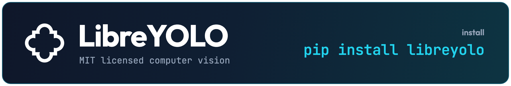
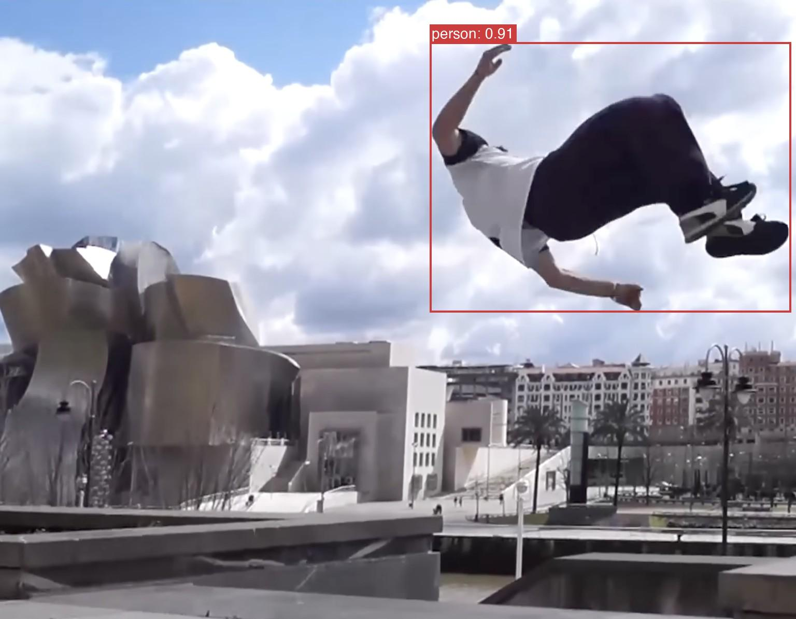

<div align="center">



<br>

LibreYOLO is an MIT licensed computer vision library to train, run, and export computer vision models.

[](https://pypi.org/project/libreyolo/)
[](https://pepy.tech/projects/libreyolo)
[](LICENSE)
[](https://www.libreyolo.com/docs)
[](https://huggingface.co/LibreYOLO)
[](https://colab.research.google.com/github/LibreYOLO/libreyolo/blob/release/notebooks/quickstart.ipynb)
[](https://www.greptile.com/?utm_source=oss_badge&utm_medium=readme&utm_campaign=greptile_for_open_source)

[English](README.md) | [简体中文](README.zh-CN.md)

</div>

> ⭐ **Support LibreYOLO.** The best way to help is to **star the repo**. Feel free to [open an issue](https://github.com/LibreYOLO/libreyolo/issues/new) if you encounter problems or have suggestions, and code contributions are very welcome (see [CONTRIBUTING.md](CONTRIBUTING.md)). If you want to contribute economically, that is very welcome: see the [sponsorship program](SPONSORS.md).

<p align="center"></p>

## Install

```bash
pip install libreyolo
```

<details>
<summary><b>Optional extras</b></summary>

<br>

The base install covers YOLOv9 and the other core detectors, training, and
inference. Add an extra when you need a heavier family or an export backend.
Comma-separate to combine, for example `pip install "libreyolo[rfdetr,hub-kernels]"`.

| Group | Extras |
| --- | --- |
| Export | `onnx`, `tensorrt`, `openvino`, `coreml`, `coreai`, `tflite` (alias `litert`), `ncnn`, `mnn`, `paddle`, `executorch` |
| Serving | `triton` |
| Models | `rfdetr`, `vlm`, `sam`, `openvocab`, `clip`, `siglip2`, `eomt`, `midas`, `modus`, `sensenova`, `gaze`, `gen` |
| Training | `lora`, `plots`, `tensorboard`, `mlflow`, `wandb`, `comet`, `clearml`, `neptune`, `dvclive` |
| Speed | `fast-eval`, `hub-kernels` |
| Sources | `stream` |
| Everything | `pip install "libreyolo[all]"` |

`executorch`, `coreai`, `paddle` and `neptune` are deliberately left out of
`all`: they pin torch, onnx or protobuf in ways that would drag the rest of the
environment with them. `fast-eval` and `hub-kernels` are not in `all` either.
Full list and per-backend notes in the
[install guide](https://www.libreyolo.com/docs/install).

</details>

<details>
<summary><b>Install from source</b></summary>

<br>

```bash
git clone https://github.com/LibreYOLO/libreyolo.git
cd libreyolo
pip install -e .
```

A plain clone checks out `release`, the stable branch matching the published
package. For unreleased work, `git checkout dev`.

</details>

<details>
<summary><b>If huggingface.co is blocked (mainland China)</b></summary>

<br>

Weights download from Hugging Face. LibreYOLO honours the standard
`HF_ENDPOINT` variable, so you can point it at a mirror such as
[hf-mirror.com](https://hf-mirror.com), a community mirror not run by
Hugging Face or LibreYOLO:

```bash
export HF_ENDPOINT=https://hf-mirror.com
```

Or download the file manually, for example
`https://hf-mirror.com/LibreYOLO/LibreYOLO9t/resolve/main/LibreYOLO9t.pt`,
and pass its local path: `LibreYOLO("path/to/LibreYOLO9t.pt")`.

</details>

## Train

```python
from libreyolo import LibreYOLO

model = LibreYOLO("LibreYOLO9t.pt")
model.train(data="dataset.yaml", epochs=100, imgsz=640)
```

```bash
libreyolo train --model yolo9-t --data dataset.yaml --epochs 100
```

See the [training guide](https://www.libreyolo.com/docs/train) to read about
multi-GPU, LoRA, layer freezing, distillation, from-scratch training,
resume, mixed precision, early stopping and logging.

## Inference

```python
from libreyolo import LibreYOLO, SAMPLE_IMAGE

model = LibreYOLO("LibreYOLO9t.pt")
result = model(SAMPLE_IMAGE, save=True)
```

Load any model straight from Hugging Face by its repo name: `LibreYOLO("LibreYOLO/LibreRFDETRn")`.

Sources are not just files. Point it at a webcam, an RTSP stream, a video, a
directory, a YouTube URL or your screen:

```bash
libreyolo predict --model yolo9-t --source 0 --show          # webcam
libreyolo predict --model yolo9-t --source rtsp://camera/1   # network camera
libreyolo predict --model yolo9-t --source screen            # screen capture
```

See the [inference guide](https://www.libreyolo.com/docs/predict) to read about
sources, results, thresholds and performance.

## Export

Twelve formats: ONNX, TorchScript, TensorRT, OpenVINO, CoreML, Core AI, TFLite
(LiteRT), NCNN, MNN, RKNN, Paddle and ExecuTorch. Plus NVIDIA Triton serving
and DeepStream config generation.

```bash
libreyolo export --model yolo9-t --format onnx
```

See the [export guide](https://www.libreyolo.com/docs/export) for each
format. Support varies by family and task, see the
[export matrix](https://www.libreyolo.com/docs/reference/export-matrix).

## Documentation

- [Docs](https://www.libreyolo.com/docs) covers install, tasks, models, training, prediction, export and the CLI
- [Benchmarks](https://www.visionanalysis.org/) on Vision Analysis
- [CHANGELOG.md](CHANGELOG.md) for what changed

## Complete list of models

LibreYOLO is organized by task, such as detection, segmentation or
classification. Each task has several models, and each model comes in several
variants. For example, `LibreYOLO9t` is task detection, model YOLO9 and
variant `t`, which means tiny. Click a model to open its documentation page.

<details>
<summary><b>All tasks and models</b></summary>

<br>

| Task | Models |
| --- | --- |
| **Detection** | [YOLOv9](https://www.libreyolo.com/docs/models/yolov9), [RF-DETR](https://www.libreyolo.com/docs/models/rf-detr), [YOLOX](https://www.libreyolo.com/docs/models/yolox), [YOLO-NAS](https://www.libreyolo.com/docs/models/yolo-nas), [D-FINE](https://www.libreyolo.com/docs/models/d-fine), [DEIM](https://www.libreyolo.com/docs/models/deim), [RT-DETR v1/v2/v4](https://www.libreyolo.com/docs/models/rt-detr), [RTMDet](https://www.libreyolo.com/docs/models/rtmdet), [PicoDet](https://www.libreyolo.com/docs/models/picodet), [PP-YOLOE](https://www.libreyolo.com/docs/models/ppyoloe), [YOLOv7](https://www.libreyolo.com/docs/models/yolov7), [EfficientDet](https://www.libreyolo.com/docs/models/efficientdet), and the classics: [DETR](https://www.libreyolo.com/docs/models/detr), [Deformable DETR](https://www.libreyolo.com/docs/models/deformable-detr), [DINO-DETR](https://www.libreyolo.com/docs/models/dino-detr), [LW-DETR](https://www.libreyolo.com/docs/models/lw-detr), [Faster R-CNN](https://www.libreyolo.com/docs/models/faster-rcnn), [RetinaNet](https://www.libreyolo.com/docs/models/retinanet), [SSD](https://www.libreyolo.com/docs/models/ssd), [FCOS](https://www.libreyolo.com/docs/models/fcos), [CenterNet](https://www.libreyolo.com/docs/models/centernet) |
| **Tiny objects** | [TinyFormer](https://www.libreyolo.com/docs/models/tinyformer), [Dome-DETR](https://www.libreyolo.com/docs/models/dome-detr) (aerial, drone, remote sensing) |
| **Instance segmentation** | [RF-DETR](https://www.libreyolo.com/docs/models/rf-detr), [RTMDet](https://www.libreyolo.com/docs/models/rtmdet), [D-FINE](https://www.libreyolo.com/docs/models/d-fine), [Mask R-CNN](https://www.libreyolo.com/docs/models/mask-rcnn) |
| **Promptable segmentation** | [SAM](https://www.libreyolo.com/docs/models/sam), [SAM 2](https://www.libreyolo.com/docs/models/sam-2), [SAM 3](https://www.libreyolo.com/docs/models/sam-3), [MobileSAM](https://www.libreyolo.com/docs/models/mobilesam), [EdgeTAM](https://www.libreyolo.com/docs/models/edgetam), [PicoSAM3](https://www.libreyolo.com/docs/models/picosam3) |
| **Semantic segmentation** | [SegFormer](https://www.libreyolo.com/docs/models/segformer), [PIDNet](https://www.libreyolo.com/docs/models/pidnet), [PP-LiteSeg](https://www.libreyolo.com/docs/models/ppliteseg), [U-Net](https://www.libreyolo.com/docs/models/unet), [DeepLabv3](https://www.libreyolo.com/docs/models/deeplabv3), [FCN](https://www.libreyolo.com/docs/models/fcn), [LingBot-Vision](https://www.libreyolo.com/docs/models/lingbot-vision), [DINOv2](https://www.libreyolo.com/docs/models/dinov2), [EoMT](https://www.libreyolo.com/docs/models/eomt) |
| **Panoptic segmentation** | [EoMT](https://www.libreyolo.com/docs/models/eomt) |
| **Pose** | [RF-DETR](https://www.libreyolo.com/docs/models/rf-detr), [YOLO-NAS](https://www.libreyolo.com/docs/models/yolo-nas), [HRNet](https://www.libreyolo.com/docs/models/hrnet), [DEKR](https://www.libreyolo.com/docs/models/dekr), [EC](https://www.libreyolo.com/docs/models/edgecrafter) |
| **Oriented boxes** | [RF-DETR](https://www.libreyolo.com/docs/models/rf-detr), [RT-DETRv2](https://www.libreyolo.com/docs/models/rt-detr), RiO-DETRv2, [YOLO-NAS-R](https://www.libreyolo.com/docs/models/yolo-nas) |
| **3D detection** | [WildDet3D](https://www.libreyolo.com/docs/models/wilddet3d), [3D-MOOD](https://www.libreyolo.com/docs/models/3d-mood), [FCOS3D](https://www.libreyolo.com/docs/models/fcos3d), [DetAny3D](https://www.libreyolo.com/docs/models/detany3d) (separate runtime) |
| **Classification** | [MobileNetV4](https://www.libreyolo.com/docs/models/mobilenetv4), [ConvNeXt](https://www.libreyolo.com/docs/models/convnext), [EfficientNetV2](https://www.libreyolo.com/docs/models/efficientnetv2), [ResNet](https://www.libreyolo.com/docs/models/resnet), [ViT](https://www.libreyolo.com/docs/models/vit), [Swin](https://www.libreyolo.com/docs/models/swin), [DeiT](https://www.libreyolo.com/docs/models/deit), [VGG](https://www.libreyolo.com/docs/models/vgg), [AlexNet](https://www.libreyolo.com/docs/models/alexnet), [CLIP](https://www.libreyolo.com/docs/models/clip), [SigLIP2](https://www.libreyolo.com/docs/models/siglip2), [DINOv2](https://www.libreyolo.com/docs/models/dinov2) |
| **Depth** | [Depth Anything 3](https://www.libreyolo.com/docs/models/depth-anything-3), [Depth Anything V2](https://www.libreyolo.com/docs/models/depth-anything-v2), Video Depth Anything, [ZipDepth](https://www.libreyolo.com/docs/models/zipdepth), [MiDaS](https://www.libreyolo.com/docs/models/midas), MoGe-3, Speridlabs Iris-Z |
| **Surface normals** | MoGe-3, [MoGe-2](https://www.libreyolo.com/docs/models/moge-2) |
| **Depth, normals and albedo** | [Marigold V2](https://www.libreyolo.com/docs/models/marigold-v2) |
| **Edges** | [DexiNed](https://www.libreyolo.com/docs/models/dexined), [TEED](https://www.libreyolo.com/docs/models/teed) |
| **Optical flow** | SEA-RAFT, NeuFlow v2, RAFT, WAFT, FlowSeek, DPFlow, UniMatch, MEMFOF |
| **Embeddings** | [LibreFaceEmbedder](https://www.libreyolo.com/docs/models/librefacerec), [CLIP](https://www.libreyolo.com/docs/models/clip), [SigLIP2](https://www.libreyolo.com/docs/models/siglip2), [Perception Encoder](https://www.libreyolo.com/docs/models/pe) (image, text, whole-video; also zero-shot classify), [DINOv2](https://www.libreyolo.com/docs/models/dinov2) |
| **Video embeddings** | [V-JEPA 2](https://www.libreyolo.com/docs/models/vjepa2) (clip embedding and trainable classification probe), [LeVJEPA](https://www.libreyolo.com/docs/models/levjepa) (clip and patch embeddings; CC BY-NC 4.0 weights) |
| **Body mesh** | [SAM 3D Body](https://www.libreyolo.com/docs/models/sam-3d-body), InstantHMR |
| **Restoration** | [DDColor](https://www.libreyolo.com/docs/models/ddcolor), [HVI-CIDNet](https://www.libreyolo.com/docs/models/hvi-cidnet), [LaMa](https://www.libreyolo.com/docs/models/lama), [NAFNet](https://www.libreyolo.com/docs/models/nafnet), [QuickSRNet](https://www.libreyolo.com/docs/models/quicksrnet), [Real-ESRGAN](https://www.libreyolo.com/docs/models/real-esrgan), [SwinIR](https://www.libreyolo.com/docs/models/swinir) |
| **Background removal** | [BiRefNet](https://www.libreyolo.com/docs/models/birefnet), [FeyNobg](https://www.libreyolo.com/docs/models/feynobg), [BEN2](https://www.libreyolo.com/docs/models/ben2), [ViTMatte](https://www.libreyolo.com/docs/models/vitmatte) |
| **OCR** | [PP-OCR](https://www.libreyolo.com/docs/models/pp-ocrv5), DeepSeek-OCR, DeepSeek-OCR-2, PaddleOCR-VL, GLM-OCR, Falcon OCR |
| **Document layout** | PP-DocLayoutV3 (regions plus reading order) |
| **Point detection** | [FOMO](https://www.libreyolo.com/docs/models/fomo), [LocateAnything](https://www.libreyolo.com/docs/models/locate-anything) |
| **Gaze** | [L2CS](https://www.libreyolo.com/docs/models/l2cs) |
| **Open vocabulary and VLMs** | [Grounding DINO](https://www.libreyolo.com/docs/models/grounding-dino), [OWLv2](https://www.libreyolo.com/docs/models/owlv2), [OmDet-Turbo](https://www.libreyolo.com/docs/models/omdet-turbo), [OV-DEIM](https://www.libreyolo.com/docs/models/ov-deim), [Florence-2](https://www.libreyolo.com/docs/models/florence-2), [Kosmos-2](https://www.libreyolo.com/docs/models/kosmos-2), [Qwen3-VL](https://www.libreyolo.com/docs/models/qwen3-vl), [InternVL3](https://www.libreyolo.com/docs/models/internvl3), [LFM2-VL](https://www.libreyolo.com/docs/models/lfm2-vl), [North Micro Vision](https://www.libreyolo.com/docs/models/northmicrovision), [SmolVLM2](https://www.libreyolo.com/docs/models/smolvlm2), [Gemma 4](https://www.libreyolo.com/docs/models/gemma-4), [Moondream](https://www.libreyolo.com/docs/models/moondream), [Molmo2](https://www.libreyolo.com/docs/models/molmo2), [WeVisOne-VL](https://www.libreyolo.com/docs/models/wevisone-vl), [MODUS](https://www.libreyolo.com/docs/models/libremodus) |
| **Robot actions (VLA)** | [SmolVLA](https://www.libreyolo.com/docs/models/librevla), [ACT](https://www.libreyolo.com/docs/models/librevla), [Diffusion Policy](https://www.libreyolo.com/docs/models/librevla) |
| **Image generation** | [FLUX.2 klein](https://www.libreyolo.com/docs/models/flux2-klein), [SANA-Sprint](https://www.libreyolo.com/docs/models/sana-sprint), PRX, PRXPixel, Speridlabs Iris-Z |
| **3D generation** | [Speridlabs Idol](https://www.libreyolo.com/docs/models/speridlabs-idol), TripoSplat, TRELLIS, TRELLIS.2, LGM, TripoSR, CRM, Direct3D-S2 |

</details>

Per-family sizes, checkpoints and parity evidence live in the
[model reference](https://www.libreyolo.com/docs/models).

## Follow us

- [LinkedIn](https://www.linkedin.com/company/libreyolo/)
- [Reddit](https://www.reddit.com/r/LibreYOLO/)

## Contributors

<a href="https://github.com/LibreYOLO/libreyolo/graphs/contributors">
  
</a>

## Sponsors

LibreYOLO is built in free time. To take it to the next level, we want to
train new models, such as LibreYOLO26 and MIT retrains of families with
restrictive weights. That costs rented GPU time, and to pay for it we created
the LibreYOLO Sponsorship Program. You can read all the details in
[this article](https://www.libreyolo.com/sponsors).

[](https://opencollective.com/libreyolo)

**Supporters.** Thank you to everyone who has donated:

<a href="https://github.com/picjul" title="Mattia Di Giusto"></a> <a href="https://github.com/Magellol" title="Thomas Lefebvre (ma.ge)"></a>

## License

- **Code:** MIT License.
- **Weights:** Check the license of the specific Hugging Face repo before you use one commercially. Every LibreYOLO Hugging Face model states its license.

