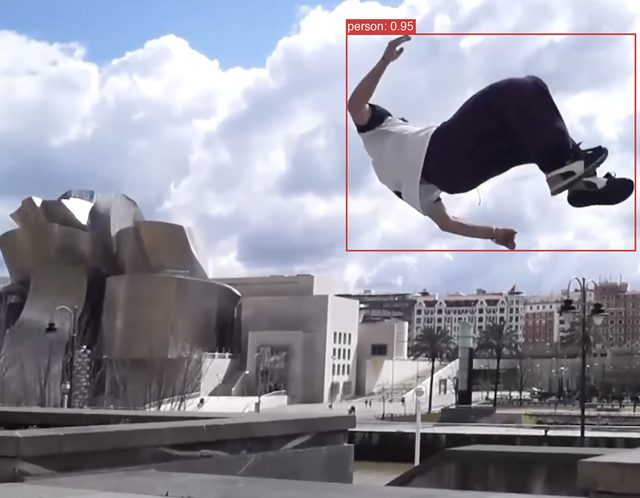
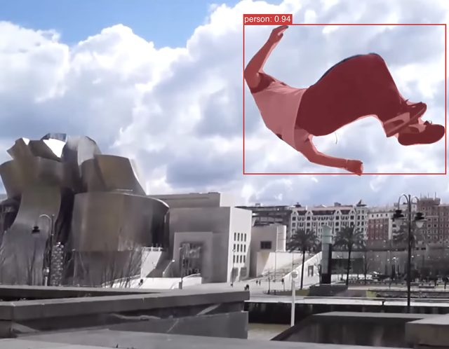
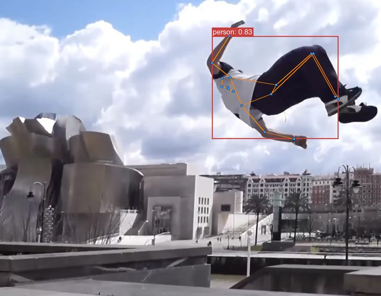
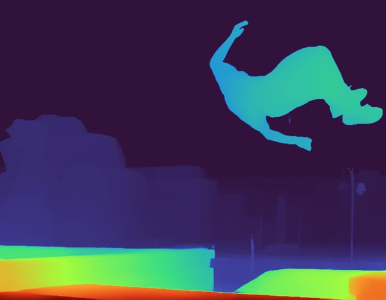
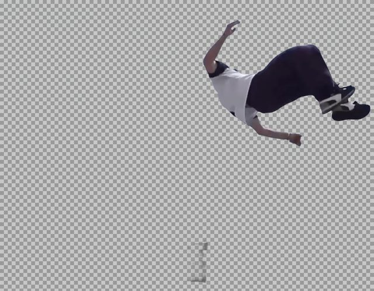
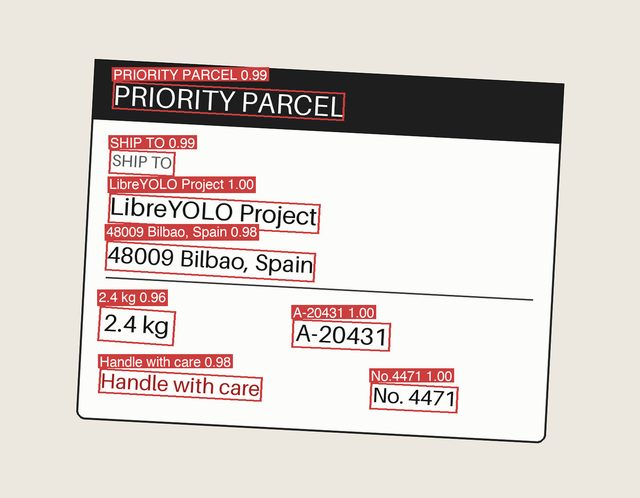
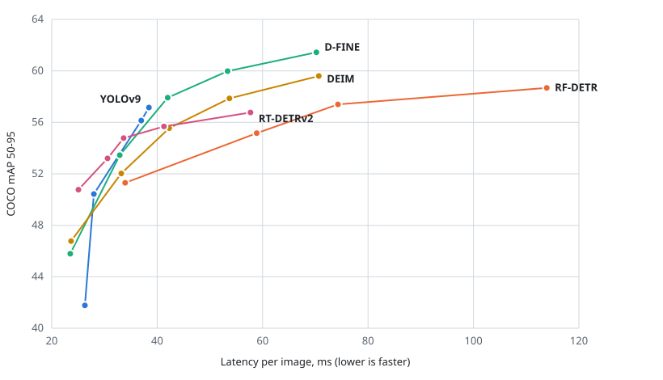

<div align="center">

<picture>
  <source media="(prefers-color-scheme: dark)" srcset="docs/readme/logo-dark.png">
  
</picture>

# LibreYOLO

**采用 MIT 许可证的计算机视觉库。**<br>
检测、分割、姿态、深度、OCR 等任务共用一套精简 API，<br>
训练和导出均已内置。

[](https://pypi.org/project/libreyolo/)
[](https://pepy.tech/projects/libreyolo)
[](LICENSE)
[](https://www.libreyolo.com/docs)
[](https://huggingface.co/LibreYOLO)
[](https://colab.research.google.com/github/LibreYOLO/libreyolo/blob/release/notebooks/quickstart.ipynb)

[English](README.md) | [简体中文](README.zh-CN.md)

</div>

> **注意：** 本中文 README 由 AI 翻译，可能包含不准确或不自然的表述。请以英文 README 为准。

<table>
  <tr>
    <td align="center"><br><b>检测</b><br><sub><code>LibreYOLO9s.pt</code></sub></td>
    <td align="center"><br><b>实例分割</b><br><sub><code>LibreRFDETRn-seg.pt</code></sub></td>
    <td align="center"><br><b>姿态</b><br><sub><code>LibreGTRs-pose.pt</code></sub></td>
  </tr>
  <tr>
    <td align="center"><br><b>深度</b><br><sub><code>LibreDepthAnythingV2s-depth.pt</code></sub></td>
    <td align="center"><br><b>背景移除</b><br><sub><code>LibreBEN2b-matte.pt</code></sub></td>
    <td align="center"><br><b>OCR</b><br><sub><code>LibrePPOCRt-ocr.pt</code></sub></td>
  </tr>
</table>

> ⭐ **支持 LibreYOLO。** 帮助项目最好的方式是给仓库 **star**。如果你遇到问题或有建议，欢迎[打开 issue](https://github.com/LibreYOLO/libreyolo/issues/new)；也欢迎代码贡献（见 [CONTRIBUTING.md](CONTRIBUTING.md)）。 如果你愿意在经济上支持项目，非常欢迎：请查看[赞助计划](SPONSORS.md)。

## 安装

```bash
pip install libreyolo
```

```python
from libreyolo import LibreYOLO, SAMPLE_IMAGE

model = LibreYOLO("LibreYOLO9t.pt")
result = model(SAMPLE_IMAGE, save=True)
```

<details>
<summary><b>可选扩展依赖</b></summary>

<br>

基础安装已覆盖 YOLOv9 与其他核心检测器、训练和推理。当你需要更重的模型系列
或某个导出后端时，再安装对应的扩展依赖即可。多个扩展用逗号组合，例如
`pip install "libreyolo[rfdetr,hub-kernels]"`。

| 分组 | 扩展依赖 |
| --- | --- |
| 导出 | `onnx`、`tensorrt`、`openvino`、`coreml`、`coreai`、`tflite`（别名 `litert`）、`ncnn`、`mnn`、`paddle`、`executorch` |
| 服务 | `triton` |
| 模型 | `rfdetr`、`vlm`、`sam`、`openvocab`、`clip`、`siglip2`、`eomt`、`midas`、`modus`、`sensenova`、`gaze`、`gen` |
| 训练 | `lora`、`plots`、`tensorboard`、`mlflow`、`wandb`、`comet`、`clearml`、`neptune`、`dvclive` |
| 提速 | `fast-eval`、`hub-kernels` |
| 输入源 | `stream` |
| 全部 | `pip install "libreyolo[all]"` |

`executorch`、`coreai` 和 `neptune` 被有意排除在 `all` 之外：它们对 torch 或
protobuf 的版本锁定会拖累环境中的其他依赖。完整列表和各后端说明见
[安装指南](https://www.libreyolo.com/docs/install)。

</details>

<details>
<summary><b>从源码安装</b></summary>

<br>

```bash
git clone https://github.com/LibreYOLO/libreyolo.git
cd libreyolo
pip install -e .
```

普通克隆会检出 `release` 分支，即与已发布包一致的稳定分支。如需获取尚未发布的
内容，请使用 `git checkout dev`。

</details>

<details>
<summary><b>国内用户：模型下载</b></summary>

<br>

模型权重从 Hugging Face 下载。如果无法访问 huggingface.co，可设置标准的
`HF_ENDPOINT` 环境变量，改用镜像站下载。[hf-mirror.com](https://hf-mirror.com)
是社区维护的镜像，并非 Hugging Face 或 LibreYOLO 官方运营：

```bash
export HF_ENDPOINT=https://hf-mirror.com
```

也可以手动下载权重文件，例如
`https://hf-mirror.com/LibreYOLO/LibreYOLO9t/resolve/main/LibreYOLO9t.pt`，
然后传入本地路径：`LibreYOLO("path/to/LibreYOLO9t.pt")`。

</details>

## 一套 API，二十二种任务

每种任务都是同样的三行代码，只有权重文件不同。

```python
from libreyolo import LibreYOLO

LibreYOLO("LibreYOLO9t.pt")("street.jpg", save=True)             # 检测
LibreYOLO("LibreDeepLabv3mv3-sem.pt")("street.jpg", save=True)   # 语义分割
LibreYOLO("LibreHRNetw32-pose.pt")("street.jpg", save=True)      # 姿态
LibreYOLO("LibreMiDaSs-depth.pt")("street.jpg", save=True)       # 深度
LibreYOLO("LibreFeyNobgl-matte.pt")("portrait.jpg", save=True)   # 背景移除
LibreYOLO("LibreRTDETRv2n-obb.pt")("aerial.jpg", save=True)      # 旋转框
LibreYOLO("LibreSEARAFTm-flow.pt")("clip.mp4", save=True)        # 光流，每对相邻帧输出一个结果
```

输入源不只是文件。它还可以是摄像头、RTSP 流、视频、目录、YouTube 链接或你的屏幕：

```bash
libreyolo predict --model yolo9-t --source 0 --show          # 摄像头
libreyolo predict --model yolo9-t --source rtsp://camera/1   # 网络摄像头
libreyolo predict --model yolo9-t --source screen            # 屏幕捕获
```

## 为什么选择 LibreYOLO

<table>
  <tr><td><b>MIT 代码</b></td><td>可用于闭源产品，无需公开你自己的代码。</td></tr>
  <tr><td><b>内置训练</b></td><td><code>model.train()</code> 支持多 GPU、LoRA、层冻结和蒸馏。</td></tr>
  <tr><td><b>内置导出</b></td><td>十二种格式，从 ONNX、TensorRT 到 CoreML、RKNN 和 ExecuTorch。</td></tr>
  <tr><td><b>沿用你的数据集</b></td><td>支持读取 YOLO 格式数据集，现有工作流只需少量改动即可迁移。</td></tr>
  <tr><td><b>一套 API</b></td><td>所有任务使用同样的调用方式。换权重，不换代码。</td></tr>
  <tr><td><b>权重许可证清晰</b></td><td><a href="https://huggingface.co/LibreYOLO">Hugging Face</a> 上的每个模型都标明了许可证。</td></tr>
</table>

一些常用的 YOLO 库采用 AGPL-3.0 许可证，基于它们构建的软件（包括网络服务）
可能需要公开源代码。LibreYOLO 的代码采用 MIT 许可证。

## 精度与速度

<picture>
  <source media="(prefers-color-scheme: dark)" srcset="docs/readme/chart-coco-latency-dark.svg">
  
</picture>

<sub>纵轴为 COCO val2017 mAP 50-95（500 张图像子集），横轴为单张图像端到端延迟
（p50，batch 1），平台为 NVIDIA Jetson Orin Nano Super 8GB，TensorRT FP16。
图中每个点都是一个 LibreYOLO 权重。数据来自
[Vision Analysis](https://www.visionanalysis.org/)，该站点还提供其他设备和运行时的结果。
图表由 [`scripts/readme/make_chart.py`](scripts/readme/make_chart.py) 生成。</sub>

## 内置内容

从经典检测器到深度估计、OCR、视频嵌入、机器人动作和 3D 生成。

<details>
<summary><b>全部任务与模型系列</b></summary>

<br>

| 任务 | 模型 |
| --- | --- |
| **检测** | YOLOv9、RF-DETR、YOLOX、YOLO-NAS、D-FINE、DEIM、RT-DETR v1/v2/v4、RTMDet、PicoDet、PP-YOLOE、YOLOv7、EfficientDet，以及经典模型：DETR、Deformable DETR、DINO-DETR、LW-DETR、Faster R-CNN、RetinaNet、SSD、FCOS、CenterNet |
| **微小目标** | TinyFormer、Dome-DETR（航拍、无人机、遥感） |
| **实例分割** | RF-DETR、RTMDet、D-FINE、Mask R-CNN |
| **可提示分割** | SAM、SAM 2、SAM 3、MobileSAM、EdgeTAM、PicoSAM3 |
| **语义分割** | SegFormer、PIDNet、PP-LiteSeg、U-Net、DeepLabv3、FCN、LingBot-Vision、DINOv2、EoMT |
| **全景分割** | EoMT |
| **姿态** | RF-DETR、YOLO-NAS、HRNet、DEKR、EC |
| **旋转框（OBB）** | RF-DETR、RT-DETRv2、RiO-DETRv2、YOLO-NAS-R |
| **三维检测** | WildDet3D、3D-MOOD、FCOS3D、DetAny3D（独立运行环境） |
| **分类** | MobileNetV4、ConvNeXt、EfficientNetV2、ResNet、ViT、Swin、DeiT、VGG、AlexNet、CLIP、SigLIP2、DINOv2 |
| **深度估计** | Depth Anything 3、Depth Anything V2、Video Depth Anything、ZipDepth、MiDaS、MoGe-3 |
| **表面法线** | MoGe-3、MoGe-2 |
| **深度、法线与反照率** | Marigold V2 |
| **边缘检测** | DexiNed、TEED |
| **光流** | SEA-RAFT、NeuFlow v2、RAFT、WAFT、FlowSeek、DPFlow、UniMatch、MEMFOF |
| **嵌入** | LibreFaceEmbedder、CLIP、SigLIP2、Perception Encoder（图像、文本、整段视频；亦支持零样本分类）、DINOv2 |
| **视频嵌入** | V-JEPA 2（片段嵌入及可训练分类探针）、LeVJEPA（片段及分块嵌入；权重采用 CC BY-NC 4.0） |
| **人体网格** | SAM 3D Body、InstantHMR |
| **图像复原** | DDColor、HVI-CIDNet、LaMa、NAFNet、QuickSRNet、Real-ESRGAN、SwinIR |
| **背景移除** | BiRefNet、FeyNobg、BEN2、ViTMatte |
| **OCR** | PP-OCR、DeepSeek-OCR、DeepSeek-OCR-2、PaddleOCR-VL、GLM-OCR、Falcon OCR |
| **文档版面分析** | PP-DocLayoutV3（版面区域及阅读顺序） |
| **点检测** | FOMO、LocateAnything |
| **视线估计** | L2CS |
| **开放词汇与 VLM** | Grounding DINO、OWLv2、OmDet-Turbo、OV-DEIM、Florence-2、Kosmos-2、Qwen3-VL、InternVL3、LFM2-VL、North Micro Vision、SmolVLM2、Gemma 4、Moondream、Molmo2、WeVisOne-VL、MODUS |
| **机器人动作（VLA）** | SmolVLA、ACT、Diffusion Policy |
| **图像生成** | FLUX.2 klein、SANA-Sprint、PRX、PRXPixel |
| **3D 生成** | Speridlabs Idol、TripoSplat、TRELLIS、TRELLIS.2、LGM、TripoSR、CRM、Direct3D-S2 |

</details>

各模型系列的尺寸、权重与一致性验证证据见[模型参考](https://www.libreyolo.com/docs/models)。

## 训练

```python
from libreyolo import LibreYOLO

model = LibreYOLO("LibreYOLO9t.pt")
model.train(data="dataset.yaml", epochs=100, imgsz=640)
```

```bash
libreyolo train --model yolo9-t --data dataset.yaml --epochs 100
```

多 GPU、LoRA、层冻结、蒸馏、从零训练，以及 TensorBoard、MLflow、
Weights & Biases、Comet、ClearML、Neptune 和 DVCLive 日志记录均受支持。
详见[训练指南](https://www.libreyolo.com/docs/train)。

## 导出与部署

十二种格式：ONNX、TorchScript、TensorRT、OpenVINO、CoreML、Core AI、
TFLite（LiteRT）、NCNN、MNN、RKNN、Paddle 和 ExecuTorch。另支持 NVIDIA
Triton 服务和 DeepStream 配置生成。

```bash
libreyolo export --model yolo9-t --format onnx
```

支持范围因模型系列和任务而异，见[导出矩阵](https://www.libreyolo.com/docs/reference/export-matrix)。

## 文档

- [文档](https://www.libreyolo.com/docs)涵盖安装、任务、模型、训练、推理、导出和 CLI
- [基准测试](https://www.visionanalysis.org/)提供独立的第三方数据
- [CHANGELOG.md](CHANGELOG.md) 记录版本变更
- [LinkedIn](https://www.linkedin.com/company/libreyolo/) 发布版本动态

## 赞助

代码在业余时间编写。训练新模型（例如 LibreYOLO26，以及为权重许可受限的模型家族重新训练 MIT 权重）需要租用 GPU，[LibreYOLO 赞助计划](SPONSORS.md)为此付费。企业每月赞助 $100 起即可在此展示 logo；每月 $500 起，还会在每次发布说明以及赞助期间发布的每个权重的模型卡中署名。硬件厂商可以通过寄送设备来赞助。

[](https://opencollective.com/libreyolo)

**支持者。** 感谢所有捐助过的朋友：

<a href="https://github.com/picjul" title="Mattia Di Giusto"></a> <a href="https://github.com/Magellol" title="Thomas Lefebvre (ma.ge)"></a>

暂无企业赞助商。

## 许可证

- **代码：** MIT License。
- **权重：** 预训练权重可能继承原始来源的许可证，且并非全部为宽松许可。
  商用前请先查看具体 Hugging Face 仓库上的许可证。每个 LibreYOLO
  Hugging Face 模型都会标明其许可证。

<br>

[](https://www.greptile.com/?utm_source=oss_badge&utm_medium=readme&utm_campaign=greptile_for_open_source)
